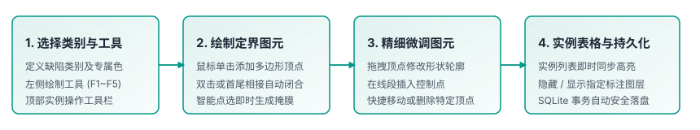
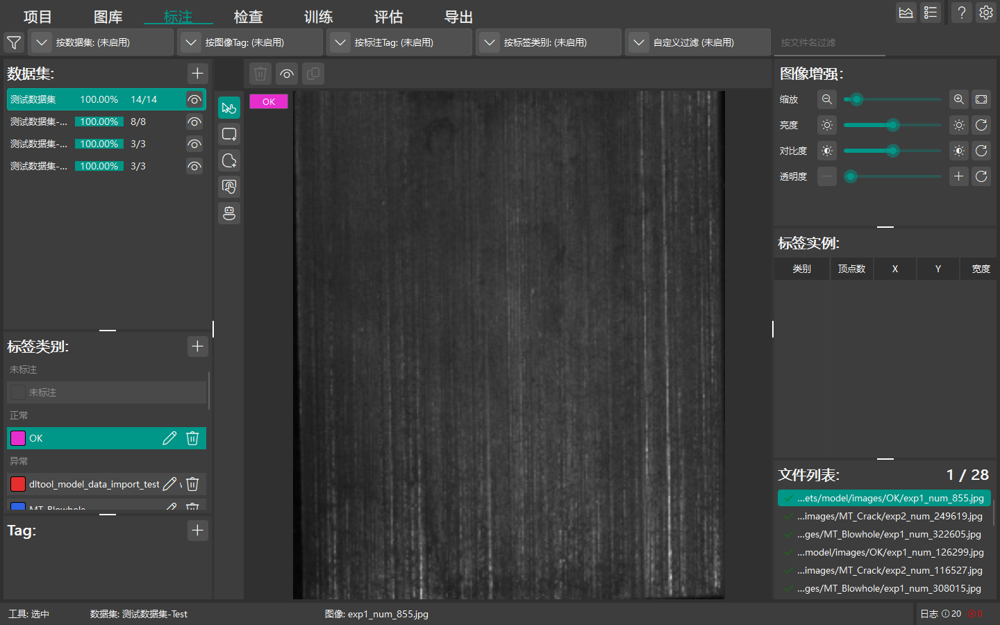

# 数据标注

本章节介绍 DeepLearningTool 中的类别管理、图形标注工具（多边形、矩形、AI 智能标注）、画布交互操作与实例管理。

返回 [手册首页](index.md) 或查看 [标注检查](guide_inspection.md)。

## 标注界面总览

在打开项目并导入样本图像后，点击顶部导航栏的 **标注** 标签进入标注主工作区。

标注界面主要由以下功能区构成：

- **左侧图像列表**：展示当前数据集的工件图像缩略图、文件名与标注状态。
- **绘制工具栏 (LabelLSidebar，画布左侧)**：提供核心标注与绘制工具切换：
  - **选中 (F1)**：选择与拖拽调整已有标注实例。
  - **绘制矩形 (F2)**：目标检测与规则缺陷的外接矩形框绘制。
  - **绘制多边形 (F3)**：精细轮廓分割与复杂几何边界绘制。
  - **智能标注 (F4)**：基于视觉基础模型的交互式点击提示分割。
  - **小样本学习 (F5)**：少样本迁移提示与微调。
- **实例工具栏 (LabelTSidebar，画布上方)**：提供当前选中标注实例的操作控制：
  - **删除选中标签实例**：删除当前选中的图元。
  - **显示外接矩形**：切换是否显示多边形图元的最小外接矩形包围盒。
  - **复制选中标签实例**：快速克隆选中的图元。
- **中间画布区 (LabelCanvas)**：高分辨率图像渲染画布，支持平滑缩放、平移以及几何图元的高精度交互绘制。
- **右侧面板**：上部为**类别管理器**（类别增删改、颜色设置、当前活动类别选择），下部为当前图像的**标注实例列表**（显示类别名、实例索引、可见性切换与删除操作）。

## 类别配置与管理

在开始绘制图元前，需要先定义目标检测或缺陷分割的分类体系：

1. **添加新类别**：在右侧类别面板点击“+ 添加类别”，输入类别英文标识或中文名称（如 `Crack`, `Pinhole`, `Scratch`）。
2. **设置专属颜色**：系统自动分派具有辨识度的初始颜色，您也可以点击色块调出取色板，自定义该类别的边框与半透明填充色。
3. **选择活动类别**：在绘制新图元前，点击选中该类别作为“当前活动类别”，后续新绘制的图形将自动绑定该类别。

## 常用标注工具与绘制流程

### 1. 多边形标注 (Polygon Tool)

适用于不规则缺陷轮廓、曲面划痕与复杂边界的目标：

- **启动绘制**：点击左侧工具栏的 **绘制多边形 (F3)** 按钮。
- **增加顶点**：在画布上移动十字光标，鼠标左键单击即可连续插入多边形顶点。
- **闭合图形**：双击鼠标左键，或点击起始锚点，即可完成闭合并生成封闭多边形图元。
- **取消绘制**：绘制过程中按下 `Esc` 键可废弃当前未闭合图元。

### 2. AI 智能标注 (Smart Annotation / SAM)

基于 Segment Anything Model 视觉基础模型，大幅加速高精细掩膜标注：

- **启动工具**：点击左侧工具栏的 **智能标注 (F4)** 按钮。
- **前景提示点 (Positive Prompt)**：鼠标左键单击目标缺陷区域，模型自动感知轮廓并生成精细预测掩膜。
- **背景排除点 (Negative Prompt)**：右键单击错误包含的正常背景区域，模型自动剔除误检区域。
- **确认转为多边形**：满意预测轮廓后按回车键或点击“确认”，系统将自动将掩膜矢量化为规则多边形图元并存入实例库。

### 3. 几何图元微调与编辑 (Shape Editor)

- **移动整体图形**：在选择模式 (F1) 下，按住多边形内部拖拽即可平移整个图元。
- **调整单顶点**：鼠标悬停在图元边缘顶点上，当控制点高亮时拖动顶点微调位置。
- **插入控制锚点**：在多边形边线上双击可插入新的控制锚点以进行细部微调；注意键盘 `Delete` 键作用于删除当前选中的整个标注实例，不可用于删除单个锚点。

## 画布交互控制

- **缩放视图**：滚动鼠标滚轮可平滑放大与缩小画布；画布支持以鼠标光标所在点为中心进行等比缩放。
- **画布平移**：按住鼠标中键（滚轮按下）或右键拖拽，可快速平移视野。
- **常用快捷键**：
  - `F1` ~ `F5`：快速切换工具模式（选中、矩形、多边形、智能标注、小样本）。
  - `Delete`：删除当前选中的标注实例。
  - `Esc`：取消当前正在绘制的多边形图元。

## 标注数据持久化

DeepLearningTool 采用行级事务自动持久化机制：一旦图元闭合或编辑完成，系统立即通过 SQLite 存储引擎落盘，底栏将实时更新已标注图像数量。无需担心意外断电或程序关闭导致标注成果丢失。
