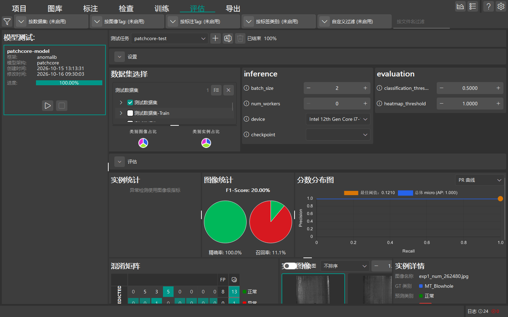

# 模型评估

本章节介绍 DeepLearningTool 模型评估视图的操作方式、性能指标解读与可视化混淆矩阵分析。

返回 [手册首页](index.md) 或查看 [模型训练](guide_training.md)。

## 评估视图概述

当模型完成训练后，点击顶部导航栏中的 **评估** 标签进入模型评估分析工作区。




评估阶段在选定的数据集（如测试集或验证集）上对模型进行端到端推理，计算统计度量指标，并提供样本级的预测结果可视化比对，用于科学评估模型在真实工业环境中的泛化性能与可靠性。

## 执行模型评估

在 DeepLearningTool 中，评估流程以 **测试任务 (Test Task)** 为组织容器与上下文，每个测试任务独立记录测试数据集、阈值配置与持久化评估结果。完整执行流程如下：

1. **创建或选择测试任务 (TestTaskPanel)**：
   - 评估操作必须在有效的测试任务上下文中执行。点击顶栏“测试任务”下拉框旁的 **添加** 按钮，在弹出的窗口中输入测试任务名称（如“测试 1”），点击确定创建。
   - 系统支持为同一项目创建多个测试任务（例如分别针对不同批次测试集或不同工况阈值进行对照），可通过下拉列表自由切换，或点击“重命名”与“删除”进行维护。
2. **选定待评估模型**：
   - 在模型列表中选中已完成训练的目标模型（模型需具有完整训练产物与数据库记录）。
3. **关联测试数据集 (TestDatasetPanel)**：
   - 在数据集列表中勾选本次测试任务参与推理的数据集：
     - 推荐选择从未参与训练与参数调优的独立 **测试集 (Test)**，以反映模型泛化能力。
     - 亦可勾选 **验证集 (Val)** 用于与训练过程监控结果相互印证。
4. **阈值参数微调**：
   - **置信度阈值 (Confidence Threshold)**：过滤置信度低于设定分数的预测目标框或类别。
   - **IOU 交并比阈值 (IOU Threshold)**：非极大值抑制 (NMS) 的重叠去重面积比率阈值。
5. **启动评估作业**：
   - 点击选定模型卡片中的 **开始**（播放图标）按钮。系统以当前激活的测试任务 UUID 作为作用域上下文启动推理计算，顶栏实时显示任务状态与完成百分比进度。
   - 评估完成后，当前测试任务下将自动呈现指标卡片、混淆矩阵与图像预测明细。

## 混淆矩阵解读 (Confusion Matrix)

混淆矩阵面板（按任务类型分为 `DetectionConfusionMatrixPanel`, `SegmentationConfusionMatrixPanel`, `AnomalyConfusionMatrixPanel`）是定位缺陷误检与漏检的核心工具：

- **真正例 (True Positive, TP)**：工件确实存在缺陷，模型正确检测出该缺陷并分类准确。
- **假正例 (False Positive, FP / 误报)**：工件为正常表面或属于其他缺陷，但模型错误预测出该缺陷（工业上称为“虚报”或“过检”）。
- **假负例 (False Negative, FN / 漏报)**：工件存在缺陷，但模型未能检出（工业上称为“漏检”，是最需重点消灭的问题）。
- **真负例 (True Negative, TN)**：工件为良品，模型正确识别为无缺陷。

```{tip}
点击混淆矩阵中特定单元格（例如 `Scratch -> Background` 漏检格子），下方实例网格将自动联动，仅列出发生该类混淆的全部样本缩略图，便于深入排查原因（如局部对比度不足或打光反光）。
```

## 关键度量指标解释

- **查准率 (Precision / 准确率)**：在所有被模型判定为某类缺陷的预测中，实际为该缺陷的比例。衡量误检率高低。
  - 计算公式：`Precision = TP / (TP + FP)`
- **召回率 (Recall / 查全率)**：在实际存在的所有该类缺陷真值中，被模型成功抓取检出的比例。衡量漏检率高低。
  - 计算公式：`Recall = TP / (TP + FN)`
- **F1 分数 (F1-Score)**：查准率与召回率的调和平均值，综合评估两者的权衡平衡。`F1 = 2 * (Precision * Recall) / (Precision + Recall)`
- **均值平均精度 (mAP)**：在目标检测与分割任务中，综合所有召回率截断点下的 PR 曲线下面积并在全类别取平均，是评价模型整体定位与分类能力的工业黄金指标。
- **异常得分与 AUROC**：在异常检测（Anomaly Detection）任务中，衡量良品与异常品像素级与图像级异常评分分布的区分度。

## 样本级预测明细与热力图

- **真值与预测值对比**：
  - **标注真值 (Ground Truth)**：采用**实线框**绘制，线条颜色对应其真实类别色彩（默认 `#00e676` 绿色）。
  - **模型预测 (Prediction)**：采用**虚线框**（线型间隔 `[6, 4]`）绘制，线条颜色对应其预测类别色彩（异常检测任务中异常品为红色、良品为绿色；默认回退 `#ff5252` 红色）。
- **异常热力图 (Anomaly Heatmap)**：异常检测模型会叠加半透明热力伪彩图，红色高亮区域即为模型识别出的潜在表面瑕疵或形变位置。
