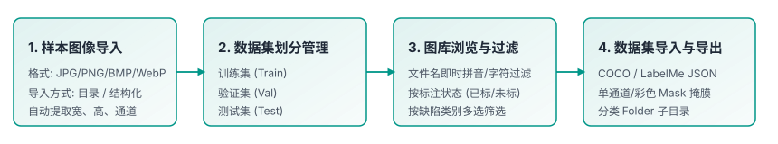
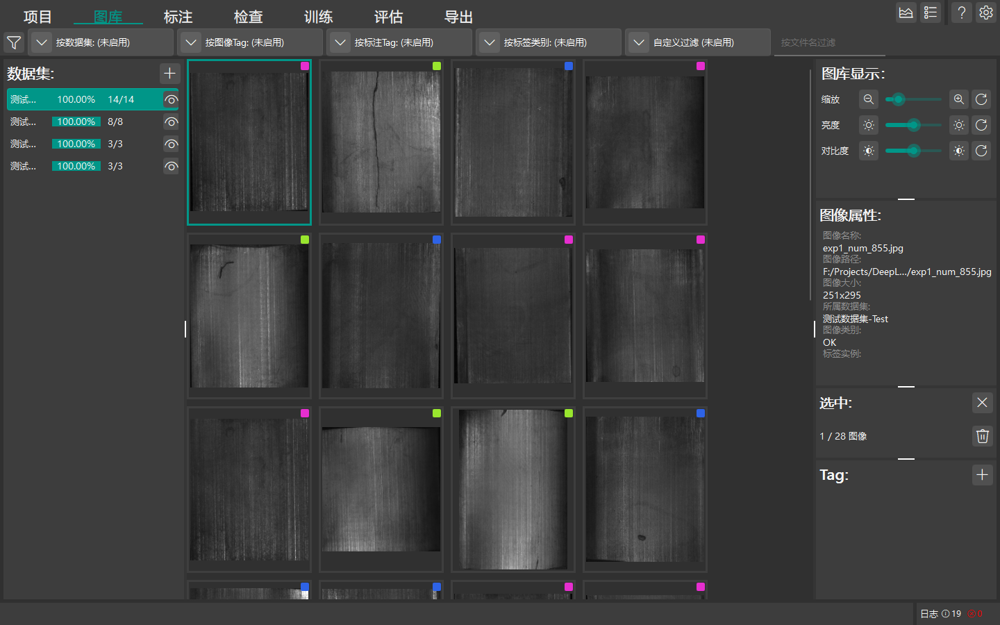

# 图库与数据集管理

本章节介绍 DeepLearningTool 图库中的图像导入、数据集拆分管理、样本过滤与数据集导出操作。

返回 [手册首页](index.md) 或查看 [项目管理](guide_project.md)。

## 图库结构总览

图库 (Gallery) 是管理和查看工程中全部样本图像与数据集划分的核心工作区。

- **图像网格**：展示当前数据集中的图像缩略图、文件名以及标注状态（绿色标记表示已标注，灰色标记表示未标注）。
- **数据集分组**：系统支持将样本拆分为不同用途的子集：
  - **训练集 (Train)**：用于模型反向传播与参数优化迭代。
  - **验证集 (Val)**：用于在训练过程中评估指标以防过拟合，并保存最优模型检查点。
  - **测试集 (Test)**：用于在完全未见样本上对最终模型执行无偏性能评估。

## 导入工件图像与数据集

所有样本图像均以数据集划分（如训练集、验证集、测试集）为单元进行组织与导入：

1. 打开项目后，切换至顶部导航栏的 **图库** 页面。
2. **确认或创建数据集**：在图库左侧的数据集分组树中，选中已有数据集；或点击左上方 **添加数据集** 创建新的子集分类。
3. **打开导入对话框**：右键点击目标数据集条目，在右键上下文菜单中选择 **导入**，系统将弹出 `DatasetDataIODialog` 导入对话框。
4. **选择数据格式**：根据项目视觉方法选择对应的导入格式：
   - **Folder 图像目录**：最常用的纯图像或按分类分目录组织形式（系统将递归扫描并导入图像）。
   - **COCO 格式**：用于带有 COCO JSON 标注的目标检测或分割数据集。
   - **LabelMe 格式**：用于带有同名 `.json` 轮廓标注的图像集。
   - **Mask 掩膜格式**：用于带有灰度/二值掩膜图像的分割与异常检测数据集。
5. **指定图像与标注目录**：
   - **图像目录**：点击图像路径右侧的 **打开** 按钮，选择存放待导入样本图像的本地文件夹。
   - **标注目录**：若需同步导入已有标注数据（如 LabelMe `.json` 轮廓文件或 Mask 掩膜图像），点击标注目录右侧的 **打开** 按钮选择标注文件所在目录；若仅需导入图像进行后续人工标定，此项可留空。
6. **支持的图像格式**：
   - JPEG 图像（`*.jpg`, `*.jpeg`）
   - PNG 图像（`*.png`）
   - BMP 图像（`*.bmp`）
   - WebP 图像（`*.webp`）
7. 点击对话框底部的 **导入** 按钮。系统在后台自动解析图像尺寸与色彩通道，并将图像索引与元数据存入项目数据库。

## 图像过滤与查找

图库提供强大的即时多维度过滤筛选能力，方便快速定位特定批次样本：

- **文件名实时检索**：顶部 Header 工具栏中的搜索输入框支持根据文件名即时过滤，键入字符后 180ms 内自动平滑刷新视图。
- **按标注状态过滤**：点击左侧过滤器，可选择仅查看“全部”、“已标注”或“未标注”样本。
- **按缺陷类别筛选**：勾选特定类别（如划痕、裂纹、杂质），网格仅显示包含该类别标注实例的图像。

## 导出数据集

需要将当前工程已完成的标注数据提供给第三方训练框架或做数据备份时，可使用数据集导出功能：

1. 在图库左侧的数据集分组树中，右键点击一个或多个选中的数据集条目。
2. 在右键上下文菜单中选择 **导出**，弹出 `DatasetDataIODialog` 导出对话框。
3. **选择导出格式**：支持导出为 COCO、LabelMe、Mask 或 Folder 格式。针对分割与异常检测任务，可额外配置单通道索引掩膜或二值化掩膜输出模式。
4. **指定输出目录**：点击浏览按钮选择本地保存文件夹，点击 **导出**。系统将把图像和标准化标注格式文件打包生成到指定目录。
