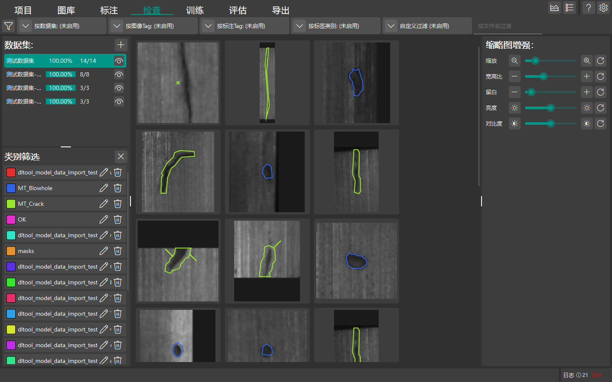

# 标注检查

本章节介绍 DeepLearningTool 的标注检查与质量复核工作流，帮助您跨图像批量审查标注一致性并快速修正错误标签。

返回 [手册首页](index.md) 或查看 [数据标注](guide_annotation.md)。

## 检查视图设计定位

在工业视觉缺陷标注项目中，往往存在多名标注人员参与、不同批次样本光照差异大或相似缺陷分类标准模糊的情况。




**检查 (Review)** 功能专门用于在模型开始训练前，对所有已标注实例进行跨样本、全局维度的集中审查与质量控制，避免脏数据损害模型训练收敛与检测精度。

```{note}
检查视图是一套人工交互式复核与批量修正工具，用于高效定位和修正人为标注偏差，而非自动算法质检。
```

## 检查界面布局

点击顶部导航栏中的 **检查** 标签进入质量复审页面：

- **左侧类别过滤器 (ClassFilterView)**：列出项目中的全部缺陷类别、未标注状态以及各类别所包含的标注实例总数。支持单选或多选类别进行聚焦过滤。
- **中间实例缩略图网格 (LabelInstancesGridView)**：集中平铺显示符合过滤条件的标注实例局部切片图（Thumbnail），直观呈现各类缺陷的真实外观细节。
- **右侧调整面板 (ReviewAdjustmentPanel)**：显示当前选中实例的详细属性（所属原图、类别、面积与坐标），并提供批量重分类与删除操作入口。

## 典型检查与修正操作流程

### 1. 过滤聚焦目标类别

- 在左侧列表中点击特定类别（例如 `Scratch`），网格区域将立即只展示所有被标注为 `Scratch` 的缺陷局部缩略图。
- 此时可快速横向比对所有被标记为该类别的工件局部，辨别是否存在混淆（如将灰尘毛絮误标为划痕）。

### 2. 局部缩略图比对与选择

- **单选实例**：鼠标单击单个缩略图，右侧面板即时显示该实例的原图上下文和所属类别。
- **多选实例**：按住 `Ctrl` 键逐个点选多个实例，或按住 `Shift` 键进行区域范围连选。
- **全选**：按快捷键 `Ctrl + A` 选中当前视图中的所有过滤实例。

### 3. 修正错误类别

如果发现若干实例被误分为其他类别：

1. 在实例网格中选中一个或多个需要修正类别的缩略图。
2. 在右侧 **所选标注信息** 面板的 **类别** 下拉选择器中，选择目标类别名称（例如修改为 `Dust`）。
3. 选中新类别后，系统将立即自动更新数据库中所有选中实例的类别归属，无需额外点击确认按钮。缩略图上的边框颜色将即时同步更新为新类别的专属色彩。

### 4. 调整缩略图显示（缩略图增强）

检查页面右侧的 **缩略图增强** 面板用于改善审查观察效果，支持调节：
- **缩放比例**：放大或缩小缺陷局部切片。
- **长宽比与外扩边距**：自适应或固定长宽比，增加周围背景上下文衬托。
- **对比度与亮度**：增强微弱对比度工件表面的缺陷可见度。

### 5. 剔除无效或误标实例

如果发现标注图元框选了无关背景、反光干扰或不符合质检标准的微弱区域：

1. 选中需要剔除的一个或多个实例缩略图。
2. 按键盘 `Delete` 键，或点击右侧面板底部的 **删除选中项** 按钮。
3. 确认后，系统将从对应图像中移除该标注图元，并自动同步更新图库状态。

### 6. 返回标注页精细重绘

如果发现某个实例的几何边界粗糙，需要重新贴合轮廓绘制：

- 双击该实例的缩略图，系统将自动跳转到 **标注** 页面，并自动定位并缩放到该实例所在的原图区域，方便您使用多边形工具进行精细调整。
