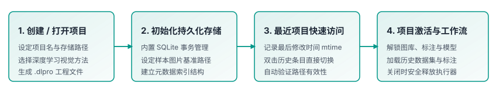
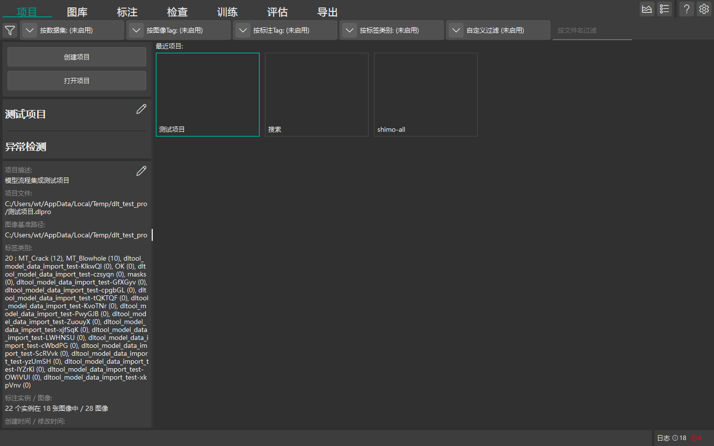

# 项目管理

本章节介绍 DeepLearningTool 的项目创建、打开、历史项目管理及持久化机制。

返回 [手册首页](index.md) 或查看 [图库与数据集管理](guide_gallery.md)。

## 项目概述与生命周期

在 DeepLearningTool 中，所有样本图像、标注数据、模型超参数和评估结果均围绕**项目 (Project)**进行统一组织与持久化管理。





- **工程文件**：每个项目由一个 `.dlpro` 工程文件承载。该文件内部采用 SQLite 数据库管理，具备事务安全与实时持久化特性，用户所做的每一步标注与配置修改均会即刻保存，无需手动频繁执行“保存”操作。
- **图片基准路径 (`imageBasePath`)**：工程记录图像文件的相对存储位置，便于数据集在团队协同或目录迁移时保持关联。

## 支持的深度学习方法

在创建项目时，需要指定该工程所专用的深度学习视觉方法（创建后项目类型固定）：

| 视觉方法 | 方法说明 | 典型工业应用场景 |
| :--- | :--- | :--- |
| **图像分类 (Classification)** | 判断整幅图像所属的全局类别 | 工件正反面识别、良品与不良品初步粗分 |
| **目标检测 (Detection)** | 预测缺陷或目标物体的外接矩形边界框与类别 | 螺丝漏装、异物检测、表面明显斑点定位 |
| **语义分割 (Segmentation)** | 像素级精细轮廓分割与区域分类 | 划痕精细轮廓、裂缝延展长度测量、涂胶区域分析 |
| **异常检测 (Anomaly Detection)** | 无监督或少样本表面异常区域检测与定位 | 复杂纹理表面未知缺陷、微弱凸起或脏污排查 |

## 创建新项目

1. 启动 DeepLearningTool，程序默认进入“项目”主界面。
2. 在左侧面板点击顶部的 **创建项目** 按钮，弹出“创建项目”配置对话框。
3. 在对话框中完成工程基础属性配置：
   - **方法选择**：在视觉方法卡片网格中选择适用的深度学习方法（图像分类、目标检测、语义分割或异常检测）。
   - **项目名称**：输入具有辨识度的项目名称（如 `Metal_Defect_Inspection`）。
   - **保存路径**：点击浏览按钮选择工程文件存放目录，系统将生成对应的 `<项目名>.dlpro` 文件。
   - **图片基准路径**（可选）：指定工件原图所在的公共基准目录。
   - **项目描述**（可选）：记录工位名称、产线批次或说明信息。
4. 确认信息无误后，点击对话框右下角的 **创建项目** 按钮。系统将自动校验路径合法性，初始化 SQLite 工程数据库并激活项目，顶栏导航标签（图库、标注、检查、模型等）随即解锁。

## 打开已有项目

DeepLearningTool 提供两种方式打开已有工程：

- **从最近项目列表打开**：项目页右侧展示最近打开过的项目卡片，显示项目名称与缩略图。直接**双击**目标卡片，或右键点击卡片并在弹出菜单中选择“打开项目”即可快速加载。
- **手动浏览打开**：在左侧面板点击“打开项目”按钮，在弹出的系统文件选择器中选择目标 `.dlpro` 文件。

```{note}
如果项目文件被移动到了新目录，直接通过左侧“打开项目”按钮重新定位移动后的 `.dlpro` 文件打开即可。
```

## 关闭与切换项目

- **切换项目**：无需手动寻找“关闭”按钮。直接通过“打开项目”或在右侧最近项目列表中双击另一项目，系统会自动保存当前工程的所有未决数据、释放前一项目的数据库连接与后台资源，并平滑切换加载新项目。
- **退出程序**：点击窗口右上角关闭按钮，系统将安全停止所有后台任务并安全清理运行时资源后退出。
