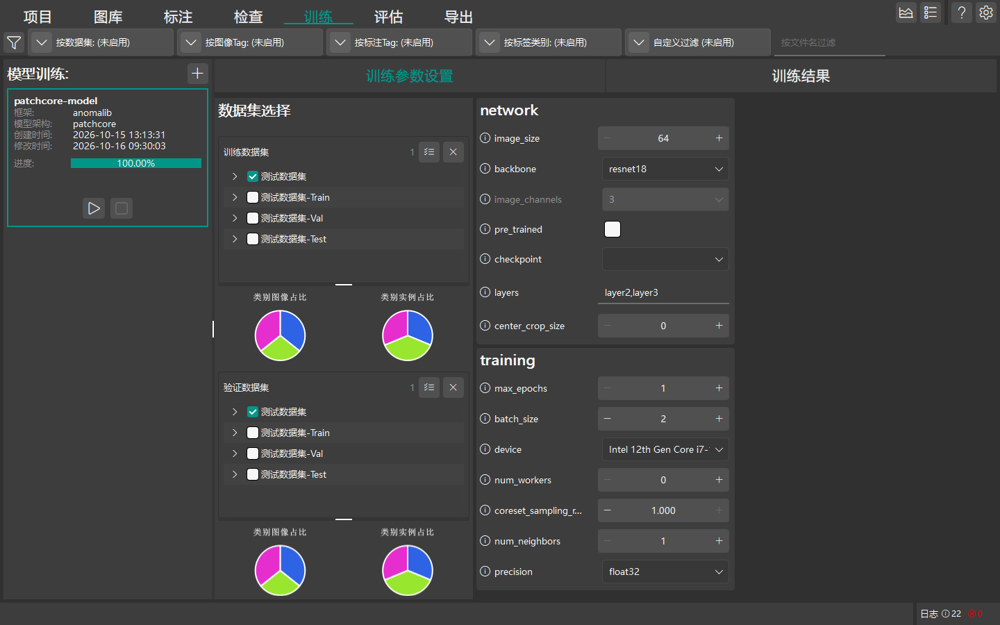

# 模型训练

本章节介绍 DeepLearningTool 模型训练的环境准备、超参数配置、启动与训练监控流程。

返回 [手册首页](index.md) 或查看 [模型评估](guide_evaluation.md)。

## 训练前提与环境要求

在启动模型训练前，请确保满足以下条件：




1. **硬件与驱动**：
   - **YOLO 等监督模型（目标检测/分割/分类）**：强烈建议具备支持 CUDA 的 NVIDIA 独立显卡（建议显存 8GB 及以上）并安装匹配的 NVIDIA 官方驱动以保证训练速度。
   - **无监督异常检测模型（PatchCore）**：支持 GPU 加速，同时也支持在 CPU 上完成特征提取与特征记忆库（Memory Bank）构建；而同属于异常检测框架的其他模型（如 Dinomaly2）则执行常规反向传播训练，建议使用 GPU 加速。
2. **数据集完备性**：
   - **监督模型（YOLO 目标检测/实例分割/分类）**：项目中已导入样本图像，并且已完成目标缺陷标签的绘制，各类别的标注样本量尽量均衡。
   - **无监督异常检测模型（PatchCore）**：仅需提供良品正常样本（Normal）用于构建特征记忆库，无需人工绘制缺陷标注。
   - **划分要求**：无论何种算法框架，均需至少包含**训练集 (Train)** 与 **验证集 (Val)** 两个划分；未划分数据集或全为空时无法启动训练。

3. **配置 Python 运行环境（必须）**：
   - 系统设置中的“Python 环境目录”默认为空。**在首次启动训练任务前，必须在系统设置中指定有效的 Python 环境目录**（包含已安装 PyTorch 及对应算法框架依赖的 Python 环境；若进行 GPU 训练则需配套安装 CUDA 与驱动，若仅在 CPU 上运行 PatchCore 则无需 CUDA 依赖）。
   - **配置路径**：点击主界面右上角顶栏的 **设置** 按钮（齿轮图标） $\rightarrow$ 选择 **软件设置 (SoftwareSetting)** $\rightarrow$ 找到 **Python 环境目录** 项，点击右侧文件夹按钮选择本机的 Python 环境根目录（例如 Anaconda 环境目录或 Python 虚拟环境根目录）。
   - 若未配置或指定目录不存在，任务准备阶段将直接报错提示“未配置 Python 环境目录”或“Python 环境目录无效”并拒绝启动训练（详见 [高级设置指南](guide_advanced.md)）。

```{important}
文档构建工具链（Sphinx/Jieba）仅用于生成和离线阅读本手册；模型训练由随发布包分发的 EasyTrain 调度运行时通过用户在“软件设置”中配置的 Python 环境及 PyTorch/CUDA 引擎协同执行，启动前请务必确认该配置项已正确填写。
```

## 模型训练完整操作流程

点击顶部导航栏中的 **训练** 标签进入模型训练工作区。界面左侧为模型列表 (`ModelView`)，右侧为训练配置与状态监控面板 (`TrainPanel`)。

### 1. 添加与选择模型 (ModelView)

1. **添加新模型**：在左侧模型列表顶部 Header 点击 **`+`**（添加模型）按钮，弹出“添加模型”对话框。
2. **选择框架与骨干架构**：在对话框中选择训练框架（如 YOLO、Anomalib 等）与具体的模型网络架构（Architecture），输入自定义模型名称后确认创建。
3. **选定活动模型**：在左侧列表中单击选中刚创建或待训练的模型卡片，右侧面板将自动加载该模型对应的配置项。

### 2. 关联训练与验证数据集 (TrainDatasetsPanel)

在右侧“训练参数设置”标签页中，左侧子面板为 **数据集选择 (TrainDatasetsPanel)**：

- **训练数据集**：勾选参与梯度反向传播更新权重的目标数据集（例如缺陷样本集与正常样本集）。
- **验证数据集**：勾选在各 Epoch 结束后参与模型指标验证与早停判定的数据集。

### 3. 配置训练超参数 (TrainParamsForm)

在右侧表单区域中，对选定模型的超参数进行调整与优化：

- **批大小 (Batch Size)**：单次前向与反向传播的样本批次大小。显存较小时（如 6GB~8GB）建议设置为 4 或 8；显存充裕时可设为 16 或 32。
- **训练轮数 (Epochs)**：数据集完整遍历训练的总次数。工业缺陷检测通常设置为 50~300 轮，配合早停策略防止过拟合。
- **初始学习率 (Learning Rate)**：梯度下降步长。常见设置为 `0.001` 或 `0.01`，训练过程将根据选定的调度器自动退火衰减。
- **图像输入尺寸 (Image Size)**：进入模型前统一缩放的分辨率（如 640x640 或 1024x1024）。尺寸越大对微小缺陷分辨力越强，但显存开销与训练耗时相应增加。
- **数据加载工作线程数 (Workers)**：后台多进程加载并增强图像的线程数，通常设置为 CPU 物理核心数的一半。

### 4. 启动与监控训练任务

1. 确认数据集勾选无误且超参数配置合理。
2. 在左侧模型列表中，点击选中模型卡片上的 **开始**（播放图标）按钮启动训练作业。
3. 系统将通过任务管理系统启动独立的后台模型训练进程，界面自动切换或可手动切换至 **训练结果** 标签页进行实时监控：
   - **损失与指标监控 (TrainStatusPanel)**：实时绘制训练损失 (Train Loss) 与验证损失 (Val Loss) 的迭代下降趋势，同步展示各 Epoch 的指标变化。
   - **TensorBoard 可视化**：内嵌或联动启动 TensorBoard 深入洞察各层特征权重与激活分布。
4. **任务控制**：训练过程中可随时点击模型卡片上的 **停止** 按钮提前终止任务。停止操作将向后台训练子进程发送终止信号；磁盘上已保存的历史轮次检查点（如已落盘的 checkpoint 或验证保存的 `best.pt`/`last.pt`）将被保留，但未完成或未落盘的当前轮次数据不会被保存。

## 权重产出与检查点

训练执行完成后，系统自动在 `models/<模型名>/train/` 目录下生成训练产物与检查点：
- **异常检测模型（如 PatchCore / Anomalib）**：产出 PyTorch Lightning 格式模型权重 `models/<模型名>/train/weights/model.ckpt`。
- **YOLO / 目标检测与分割模型**：产出 PyTorch 格式的最优权重 `best.pt`（验证集指标最高）与最新轮次检查点 `last.pt`。
- **训练执行日志**：所有控制台输出与指标日志统一保存在 `models/<模型名>/train/logs/train.log` 中。

