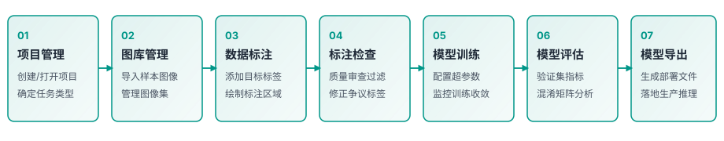

# 快速上手

本章节介绍 DeepLearningTool 的核心概念、主要工作流与界面布局，帮助您快速开始第一个深度学习视觉任务。

返回 [手册首页](index.md)。

## 工作流总览

DeepLearningTool 针对工业视觉缺陷检测与模式识别场景设计，典型工作流包含以下主要阶段：

1. **项目管理**：创建新项目或打开已有工程，设定任务类型与存储目录。
2. **图库管理**：导入工件图像样本，按训练、验证和测试集组织数据。
3. **数据标注**：针对具体视觉任务进行精细化标注，配置类别与缺陷区域。
4. **标注检查**：审查标注质量，快速过滤与修正错误或争议标注。
5. **模型训练**：配置训练参数并启动训练，实时监控损失函数收敛趋势。
6. **模型评估**：基于混淆矩阵、精度指标与热力图综合评估模型泛化能力。
7. **产物交付**：提取训练好的模型权重（异常检测为 `model.ckpt`，检测分割为 `best.pt`）与标准化数据集，无缝接入工业产线检测系统。

## 界面布局

DeepLearningTool 界面主要由三部分组成：

- **顶部导航栏 (Header)**：包含项目基本信息、主要功能页面切换标签（图库、标注、检查、模型等）、任务中心入口以及右上角 **帮助** 下拉菜单。点击 **帮助 → 文档** 可随时打开离线用户手册。
- **工作区 (Workspace)**：展示当前所选功能的详细交互界面。例如在图库中浏览图像网格、在标注区进行精细标注或在模型页面监控训练进度。
- **状态栏 (Footer)**：显示当前操作提示、系统状态与后台任务执行进度。

## 环境要求与准备

在进行模型训练与推理之前，请确保工作站具备以下运行环境：

- **操作系统**：Windows 10 / 11 64位 或主流 64位 Linux 系统。
- **图形显卡**：NVIDIA GPU（推荐 Compute Capability 7.0 及以上架构，显存 8GB 及以上）。
- **显卡驱动**：匹配 CUDA 版本的 NVIDIA 官方最新驱动程序。
- **存储空间**：固态硬盘推荐预留至少 20GB 可用空间用于数据集与模型权重存储。
